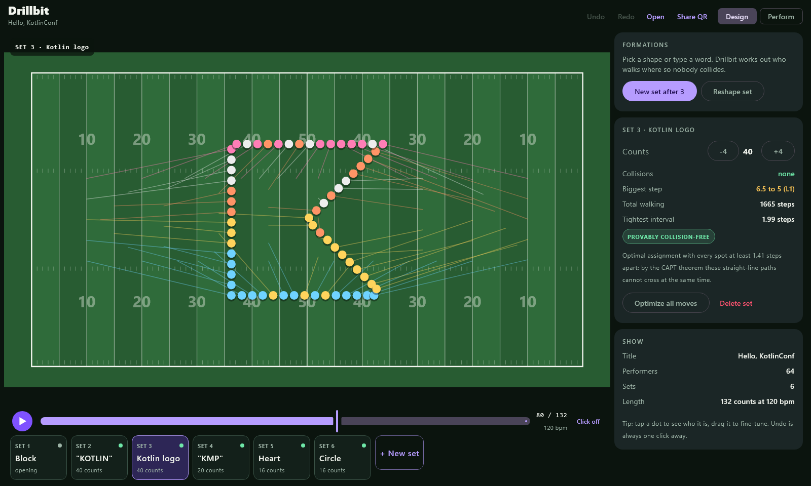
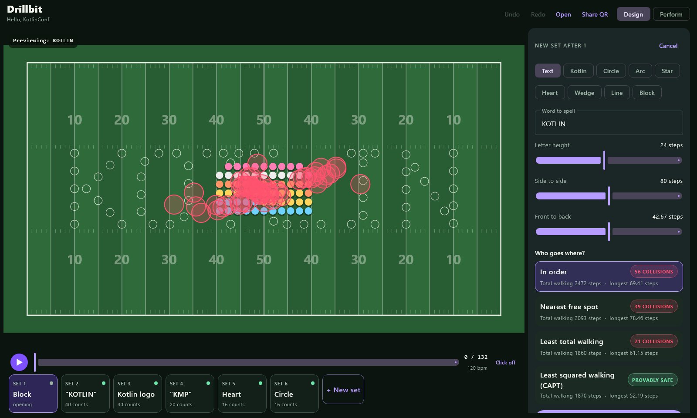
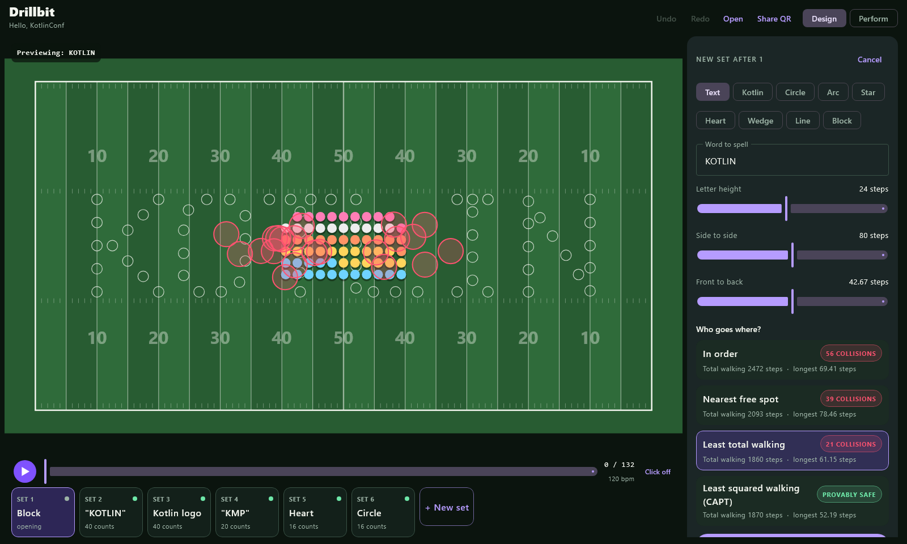
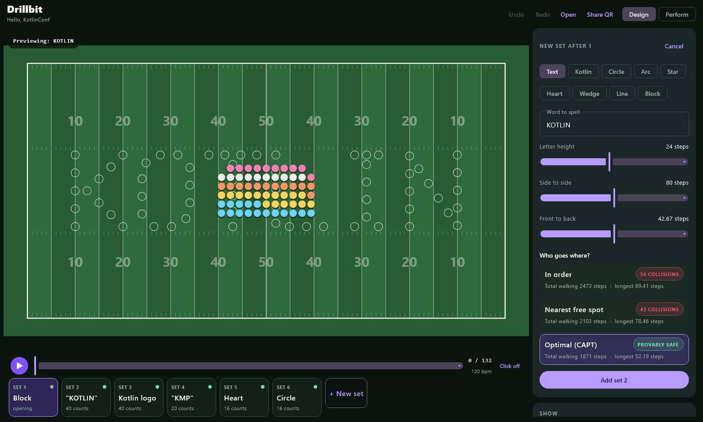
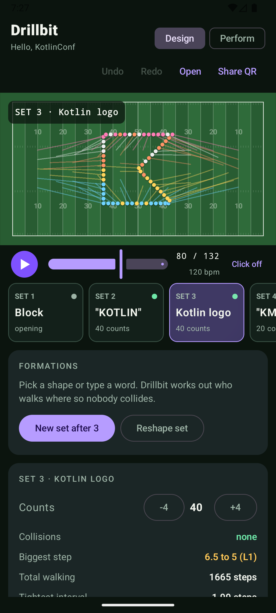
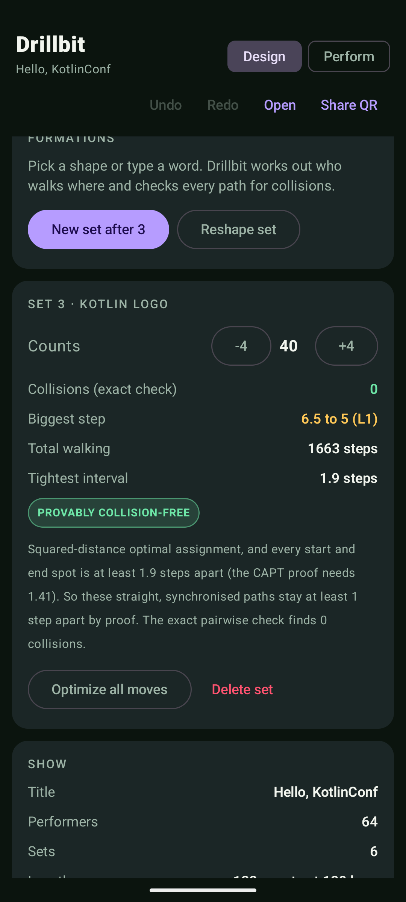
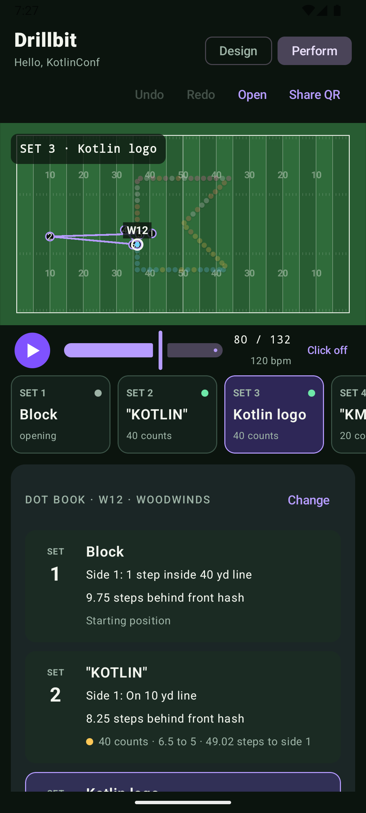
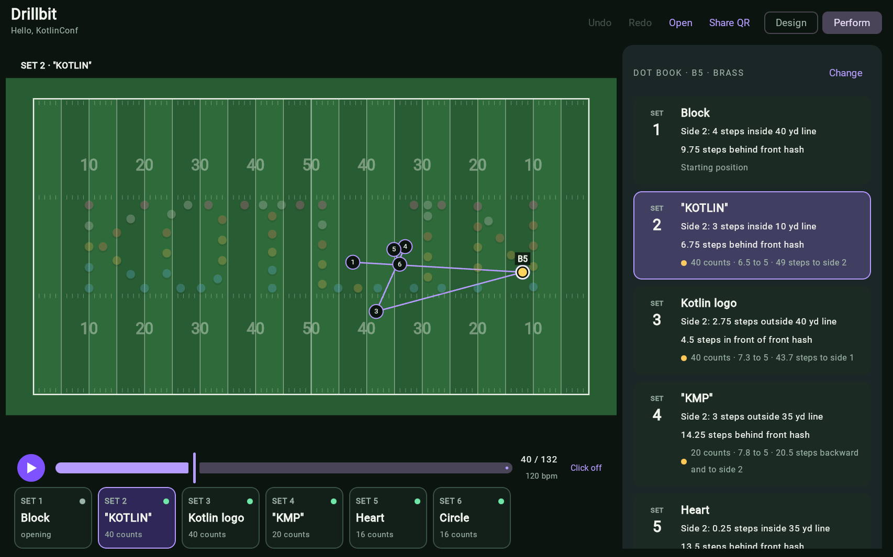
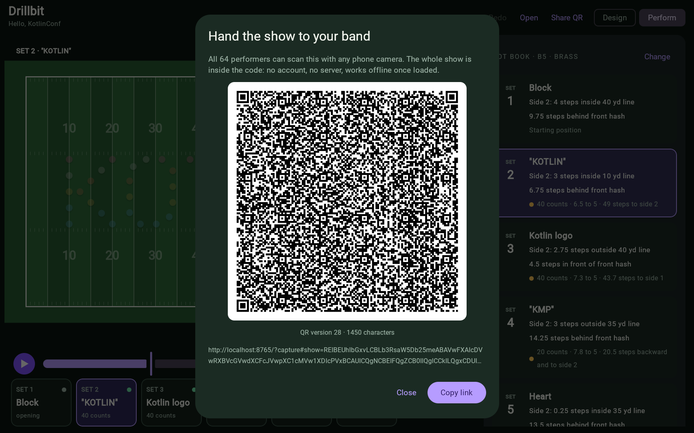

# Drillbit

**Type a word and 64 marching band members walk into it on paths that are checked for collisions exactly, and proven collision-free whenever every spot is at least 1.41 steps from the next (the CAPT condition). Then every performer scans one QR code and gets their own step-by-step dot book on their phone.**

One Kotlin Multiplatform codebase, running on **Android**, **Desktop (JVM)** and the **Web (Kotlin/Wasm)**. 95.6% of the production Kotlin is shared `commonMain` code, including the entire Compose UI (92.8% if you also count platform XML, HTML and Gradle files).



- **Try it in the browser:** <https://unknownhacker1.github.io/drillbit/> (no install, no account)
- **Android APK:** build it with one command (below), or download it from [Releases](https://github.com/UnknownHacker1/drillbit/releases) when published
- **Screencast:** _link added at submission_

---

## The problem

A marching band show is a sequence of formations ("sets"). Between sets, every member walks in a straight line at a steady stride for a fixed number of counts. Two things are hard:

1. **Deciding who goes where.** When 64 people change from a block into the word "KOTLIN", any spot can be filled by anyone. A bad choice sends people across each other's paths and they collide mid-move. Drill writers solve this by hand, often with paid desktop software.
2. **Getting each person their part.** Every member needs their own "dot book": where to stand at each set, in yard-line terms, and how big their steps are. Bands still hand these out on paper.

## What Drillbit does

| On a laptop (drill writer) | On a phone (performer) |
|---|---|
| Pick a shape (word, Kotlin logo, circle, arc, star, heart, wedge, line, block) and Drillbit computes the **optimal assignment** of performers to spots. | Scan the QR code. The web app opens straight into **Perform** mode with the whole show inside the link. |
| Compare four plans side by side: *in order*, *nearest free spot*, *least total walking* (Hungarian on plain distance) and *least squared walking* (Hungarian on squared distance, the CAPT planner). Watch the first three collide while the dots walk (red rings). | Tap your dot or your label and get **your dot book**: "Side 2: 3 steps inside 10 yd line, 6.75 steps behind front hash, 40 counts, 6.5 to 5, 49 steps to side 2". |
| Every move gets a report: collisions from an exact pairwise check, biggest stride in band language ("6 to 5"), tightest interval, and a **PROVABLY COLLISION-FREE** badge only when the CAPT condition holds (otherwise it says *CHECKED: 0 COLLISIONS* and why there is no proof). | Your route through the whole show is drawn on the field with numbered sets. Play the show with a metronome click at tempo. |
| Drag dots to fine-tune, undo/redo, play the show, fix counts with one click. | Nothing is uploaded anywhere: the show lives inside the link. No server, no account, nothing to install. |

**Same 64 performers, same block, same "KOTLIN" (24-step letters, 40 counts), four ways to decide who goes where.** Collisions are colliding pairs from the exact check, pinned by a unit test (`PlannerTest.squaringTheDistancesIsWhatRemovesTheCollisions`):

| Plan | How | Collisions |
|---|---|---:|
| In order | performer *i* takes spot *i* | 56 |
| Nearest free spot | greedy, in roster order | 39 |
| Least total walking | Hungarian, minimise sum of distances | 21 |
| Least squared walking (CAPT) | Hungarian, minimise sum of squared distances | **0** |

Minimising plain distance is not enough: two crossing paths can be exactly as short as two parallel ones. Squaring the cost is what removes the crossings.

| In order: 56 collisions | Least total walking: 21 | Least squared walking: 0 |
|---|---|---|
|  |  |  |

| Android (emulator) | Android: why the move is safe | Android, perform mode |
|---|---|---|
|  |  |  |

| Web (Kotlin/Wasm): a performer's dot book and route | Web: the share QR code |
|---|---|
|  |  |

## What is new here

- **The CAPT insight applied to marching.** In robotics, *Concurrent Assignment and Planning of Trajectories* (Turpin, Michael and Kumar, IJRR 2014) proves that if robots start and stop together and move in straight lines, the assignment minimising the **sum of squared distances** keeps them apart as long as every start and goal spot is at least 2&radic;2&middot;R from the next. A band moving between sets is that setting. With R = half a step (performers stay at least one step apart), the condition is 1.41 steps. Drillbit computes the actual tightest spacing of every move and shows the proof badge only when it holds. Independently, it checks every pair of paths exactly (closed-form closest approach), so moves without a proof still get an honest collision count.
- **Designer-to-performer handoff with no backend.** A show is packed into a ~1 KB binary code (delta coding, zig-zag varints, CRC-32), put in the URL fragment and rendered as a QR code by an encoder written from the ISO spec in common Kotlin. The same codec reads it on any platform.
- **Band language, not coordinates.** Positions are written the way drill charts write them (yard lines, inside/outside, hashes, "N to 5" step sizes), computed from the geometry.

## Kotlin Multiplatform

```
                         ┌──────────────────────────────────────────────┐
                         │  :core  (commonMain, no UI, no dependencies)  │
                         │  model · Hungarian/CAPT planner · collisions  │
                         │  shapes + stroke font · dot book · codec · QR │
                         │  timeline · immutable edits · undo history    │
                         └───────────────────────┬──────────────────────┘
                                                 │
                         ┌───────────────────────┴──────────────────────┐
                         │  :composeApp  commonMain  (Compose MPP UI)    │
                         │  field canvas · design & perform panels ·     │
                         │  share/import dialogs · state holder · theme  │
                         │  expect: platformName, webAppUrl, playTick,   │
                         │          textClipEntry  + ShowStorage iface   │
                         └──────┬───────────────────┬───────────────┬───┘
                                │                   │               │
                  ┌─────────────┴──────┐ ┌──────────┴───────┐ ┌─────┴──────────────┐
                  │ androidMain +      │ │ desktopMain      │ │ wasmJsMain         │
                  │ :androidApp        │ │ JVM, Swing window│ │ browser, URL hash  │
                  │ SharedPreferences, │ │ file storage,    │ │ localStorage,      │
                  │ ToneGenerator,     │ │ javax.sound,     │ │ WebAudio,          │
                  │ intent links       │ │ AWT clipboard    │ │ ComposeViewport    │
                  └────────────────────┘ └──────────────────┘ └────────────────────┘
```

**Shared code.** Method: non-blank, non-comment lines of production Kotlin, `commonMain` versus every platform source set. Tests and generated code are left out of both sides. Reproduce with `./gradlew sharedCodeReport`.

| Source set | Lines | |
|---|---:|---|
| `core/commonMain` | 1754 | shared |
| `composeApp/commonMain` | 1829 | shared (all UI) |
| `composeApp/androidMain` | 26 | Android |
| `composeApp/desktopMain` | 68 | Desktop |
| `composeApp/wasmJsMain` | 55 | Web |
| `androidApp/main` | 17 | Android |
| **Production Kotlin** | **3749** | **95.6% shared** (3583 of 3749) |
| + platform XML, HTML and Gradle (manifest, launcher icon, `index.html`, `androidApp/build.gradle.kts`) | +113 | **92.8% shared** (3583 of 3862) |

`core` has no platform code at all. Everything a user sees or does is common code. Each platform only supplies storage, a metronome tick, the clipboard entry type, its own URL and the entry point. Those are `expect`/`actual` functions plus one small `ShowStorage` interface.

Project layout:

```
core/            pure Kotlin Multiplatform library: jvm, android, wasmJs
composeApp/      Compose Multiplatform UI: commonMain + androidMain, desktopMain, wasmJsMain
androidApp/      Android application module (AGP 9 structure): MainActivity + manifest
```

Built with Kotlin 2.4.21, Compose Multiplatform 1.12.2, Android Gradle Plugin 9.4.1, Gradle 9.8.2. No third-party libraries beyond Compose and AndroidX Activity.

## Run it

Prerequisites: **JDK 17 or newer** (21 recommended) on `JAVA_HOME`. For Android, the **Android SDK** (Android Studio installs it; the build downloads platform 37 if missing). The Gradle wrapper downloads Gradle itself.

Clone:

```bash
git clone https://github.com/UnknownHacker1/drillbit.git
cd drillbit
```

On Windows use `gradlew.bat` instead of `./gradlew`.

### Desktop (Windows, macOS, Linux)

```bash
./gradlew :composeApp:run
```

Optional: pass a share link or code to open it, `./gradlew :composeApp:run --args="<link>"`. Native installers: `./gradlew :composeApp:packageDistributionForCurrentOS`.

### Android (8.0+)

With a device or emulator connected:

```bash
./gradlew :androidApp:installDebug
```

Then launch **Drillbit** from the app drawer. Or open the project in Android Studio and run the `androidApp` configuration. The APK is at `androidApp/build/outputs/apk/debug/androidApp-debug.apk`.

### Web (Kotlin/Wasm)

Fastest: open the hosted build at <https://unknownhacker1.github.io/drillbit/>. To run locally:

```bash
./gradlew :composeApp:wasmJsBrowserDevelopmentRun
```

This starts a dev server and opens the app. For the optimised build: `./gradlew :composeApp:wasmJsBrowserDistribution` and serve `composeApp/build/dist/wasmJs/productionExecutable/` with any static server (for example `python -m http.server`). Needs a browser with WebAssembly GC: current Chrome, Edge, Firefox, or Safari 18.2+.

### Tests and code style

Everything that needs no browser (JVM, Wasm under Node, the desktop UI tests, code style):

```bash
./gradlew :core:jvmTest :core:wasmJsNodeTest :composeApp:desktopTest ktlintCheck
./gradlew sharedCodeReport      # shared-code percentage, both ways of counting
```

`./gradlew allTests` also runs the `wasmJsBrowserTest` tasks, which start a headless Chrome through Karma. Use it only on a machine with Chrome or Chromium installed; the command above covers the same common tests without one.

## Try the key features (2 minutes)

1. **Watch the show.** Press play. The 64-member demo goes Block -> "KOTLIN" -> Kotlin logo -> "KMP" -> Heart -> Circle. Turn on *Click* for a metronome.
2. **See why assignment matters.** Select set 1, press **New set after 1**, keep *Text* and type a word. Under *Who goes where?* tap **In order**, **Nearest free spot**, **Least total walking**, then **Least squared walking (CAPT)**. The dots walk the move on a loop; red rings are collisions. Press **Add set**.
3. **Inspect a move.** Select any later set. The panel shows the exact collision count, the biggest stride in "N to 5" form, total walking, the tightest spacing, and either the *PROVABLY COLLISION-FREE* badge (with the spacing it relied on) or the reason there is no proof. Change counts with -4/+4 and watch the stride colour change.
4. **Edit by hand.** Drag a dot. If you create a collision, a red ring appears where it happens. **Undo** puts it back. **Optimize all moves** re-assigns people in every move without changing any picture.
5. **Hand it to the band.** Press **Share QR**. Scan it with a phone (the hosted web build opens in *Perform* mode), or copy the link and use **Open** on another device.
6. **Be a performer.** Switch to **Perform**, tap your label (say *B5*) and read your dot book; your route through the show is drawn on the field. Tap a set to jump there.

## How it works

| Piece | Where | Notes |
|---|---|---|
| Optimal assignment | `core/.../assign/Hungarian.kt` | Hungarian algorithm with potentials, O(n&sup2;m). Takes n workers and m &ge; n jobs (spare jobs unused); rejects NaN or infinite costs instead of looping. Tested against brute force on 200 square and 100 rectangular random matrices. |
| Collision check | `core/.../plan/Collisions.kt` | Closest approach of two straight-line movers is a quadratic in t; solved in closed form and clamped to [0, 1]. Checked against dense sampling. |
| CAPT guarantee | `core/.../plan/TransitionPlanner.kt` | `provablySafe` = assignment is squared-distance optimal (re-solved to check) and the tightest start or end spacing is at least 2&radic;2&middot;R. A property test checks the theorem on random formations. |
| Shapes | `core/.../shapes/` | Spots spread along strokes by arc length with largest-remainder rounding, then pushed apart where strokes meet. Words use a hand-made single-stroke font. |
| Dot book | `core/.../dotbook/DotBook.kt` | Yard line + inside/outside, nearest hash or sideline, "N to 5" stride and direction. |
| Show codec | `core/.../codec/` | "DB" magic, version, quarter-step positions, zig-zag delta varints, CRC-32, base64url. Every spot the app makes is snapped to the quarter-step grid, so a shared show decodes to exactly the same positions and keeps its proof badges (tested). Corrupt codes are rejected with a reason. |
| QR encoder | `core/.../qr/` | Byte mode, versions 1-40, Reed-Solomon over GF(256), interleaving, 8 masks with penalty scoring. Output decoded successfully by OpenCV's independent decoder (see `QrExportTest`). |
| UI | `composeApp/src/commonMain` | One adaptive Compose UI: side panel on wide windows, stacked on phones. Field drawn on a `Canvas`; no icon fonts or images needed. |

**Tests** (all pass):

| Suite | Tests | Runs on |
|---|---:|---|
| `core/src/commonTest` | 46 | JVM and Wasm (Node), plus Wasm in a headless browser via `allTests` |
| `core/src/jvmTest` | 1 | JVM (writes QR images for an external decoder when `DRILLBIT_QR_EXPORT` is set) |
| `composeApp/src/commonTest` (UI state) | 5 | JVM, plus Wasm in a headless browser via `allTests` |
| `composeApp/src/desktopTest` (screenshots) | 4 | JVM; renders the real UI off-screen, checks each frame is not blank, and writes the PNGs to `composeApp/build/screenshots` (or `DRILLBIT_SCREENSHOTS`) |

`ktlintCheck` is clean and the Kotlin compiler reports zero warnings on all three targets. (The webpack step of the web build prints its usual bundle-size notices.)

## Honest limits and what is next

- Moves are straight lines at a constant stride, as in most drill. Curved paths ("follow the leader") and holds within a move are not modelled yet.
- Personal space is fixed at 1 step between performers' centres. Players with sousaphones or drums need more; the proof scales (it needs 1.41 x clearance spacing), but there is no control for it in the UI yet.
- The proof covers the model: straight, synchronised moves of point-like performers with that clearance. Real marchers drift, which is why the app also reports the tightest spacing and the exact check.
- The QR code for the 64-member, six-set demo is version 28: it scans from a laptop screen, but a much larger show should be shared by link.
- Not built for iOS because that needs a Mac to compile. The shared code uses no JVM-only APIs, so adding `iosArm64` is a new target rather than a rewrite.
- Next: audio sync to a music file, printable dot sheets, a field view from the performer's eye line.

## License

MIT, see [LICENSE](LICENSE). Made by Abdelrahman Teima for the Kotlin Multiplatform Contest 2027.
